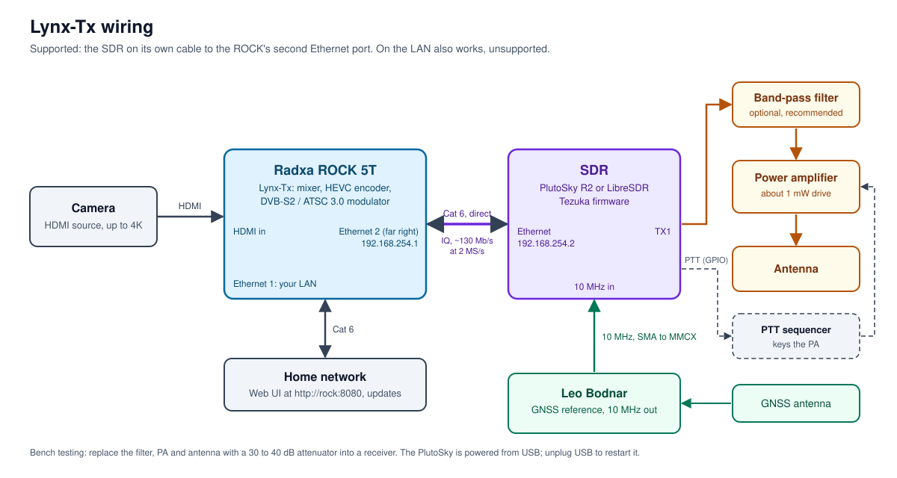
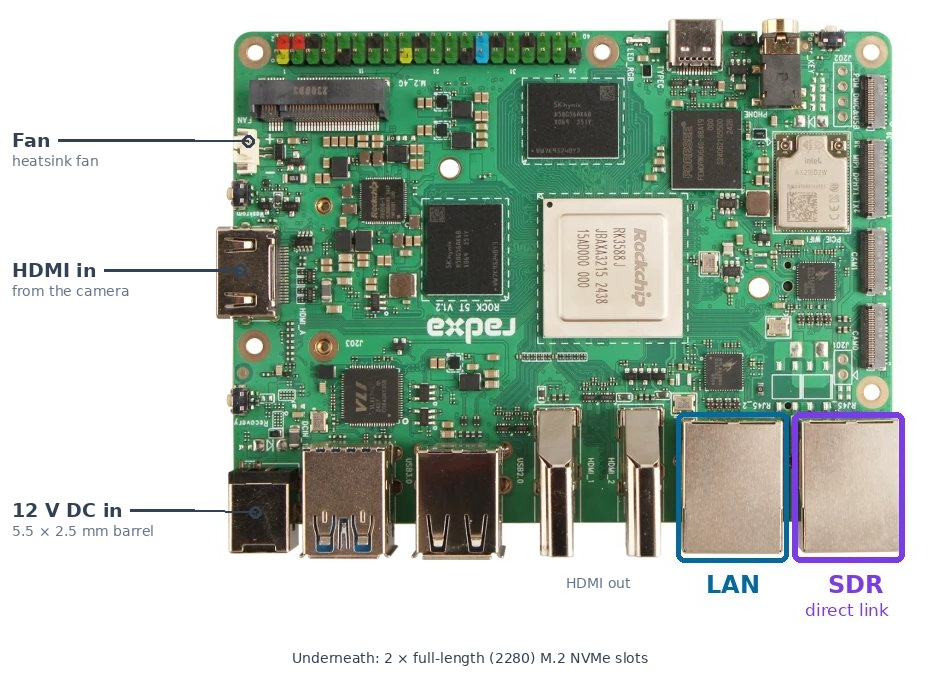

# Lynx-Tx

A 4K DATV transmitter you drive from a web page. A Radxa ROCK 5T mixes, encodes and modulates; a Pluto-class SDR on its own cable puts it on air. DVB-S2 and ATSC 3.0 from one box, with DVB-T2 coming soon: a true multi-mode television transmitter.

Companion to the [Lynx DATV receiver](https://github.com/G8YTZ/lynx-datv-receiver): same family, opposite direction.

## What it does

- **Vision mixer:** Camera (HDMI, up to 4K) and media run all the time; the cut happens in front of the encoder, with no break on air.
- **Hardware HEVC:** The RK3588's encoder does 4K25 at about a quarter of one core.
- **Frame-by-frame rate control:** Every picture's QP is chosen so the receiver's buffer is never late.
- **Sound priority:** Tables, then sound, then pictures. A picture burst cannot push the sound out.
- **Proper identity:** PAT, PMT, SDT and NIT written here, with your names, IDs and channel number.
- **DVB-S2 made on the ROCK:** Ron Economos W6RZ's gr-dtv, from 333 kS/s up, QPSK to 32APSK, exact stream rate, clean 2× oversampled spectrum.
- **ATSC 3.0:** Ron's gr-atsc3, 6 MHz, received by a shop-bought HDHomeRun FLEX 4K.
- **DVB-T2: Coming soon.** Ron's gr-dtv again, on the same IQ path, for terrestrial and narrowband DATV.
- **Any Pluto-class SDR with Ethernet:** Found automatically on the direct link, the LAN or by mDNS, with its model and firmware shown.
- **One page:** Source, encoder, identity, frequency, power, TX on and off, restart and shut down.

## Status

Beta. Proven on the bench on 18 October 2026: PlutoSky R2 and LibreSDR, 1249 MHz, QPSK 3/4 at 2000 and 4000 kS/s, the whole ROCK under 20% busy. MER on a BATC PicoTuner: 51.1 dB from the LibreSDR, 38 dB from the PlutoSky on Tezuka v0.3.24.

## Hardware

See [docs/BOM.md](docs/BOM.md). In short: a ROCK 5T, a PlutoSky R2 or LibreSDR running [Tezuka firmware](https://github.com/F5OEO/tezuka_fw/releases), a Cat 6 cable between them, and ideally a 10 MHz GNSS reference.

## Connecting the SDR

**Supported:** The SDR on its own Cat 6 cable to the ROCK's second Ethernet port (the RJ45 at the far edge of the board). The ROCK gives the SDR its address, so the SDR needs no setting up:

| | Address |
|---|---|
| ROCK, second port | 192.168.254.1 / 24 |
| SDR | 192.168.254.2, given by the ROCK (DHCP) |

Nothing else shares that cable, so the IQ stream (about 130 Mb/s at 2 MS/s, 260 Mb/s at 4 MS/s) never meets your other traffic.

**Also works, not supported:** The SDR on your LAN. Type its address into the Transmit card. Expect trouble on a busy or Wi-Fi-bridged network.

Setting both ends up: [docs/INSTALL.md](docs/INSTALL.md) and [docs/SDR_SETUP.md](docs/SDR_SETUP.md).

## Modes

| Mode | Modulator | SDR | Receiver |
|---|---|---|---|
| DVB-S2 | ROCK: gr-dtv (default) | Any Pluto-class with Ethernet, Tezuka recommended | [BATC PicoTuner (Ethernet)](https://wiki.batc.org.uk/PicoTuner_Ethernet_Interface), MiniTiouner, satellite receivers |
| DVB-S2 | LibreSDR on board: DL1JM's firmware (fallback) | LibreSDR with DL1JM firmware only | As above |
| ATSC 3.0 | ROCK: gr-atsc3 | Any Pluto-class with Ethernet | [HDHomeRun FLEX 4K (HDFX-4K)](https://shop.silicondust.com/shop/product/hdfx-4k/) |
| DVB-T2 (coming soon) | ROCK: gr-dtv | Any Pluto-class with Ethernet | DVB-T2 receivers, Lynx DVB-T2 Receiver |

## Safety

- **Test on a cable first:** A 30 to 40 dB attenuator into a receiver, never straight into a tuner.
- **PTT:** Tezuka keys its own PTT line whenever IQ is flowing. DL1JM's firmware keys from the power setting. A LibreSDR running DL1JM's firmware as an IQ transmitter does **not** key PTT: check before putting a PA behind it.
- **TX Off** sets the SDR's most attenuation (−89.75 dB) before the stream stops.
- **Your licence:** Frequency, bandwidth and power are your responsibility. A 2 MS/s DVB-S2 signal at roll-off 0.35 is 2.7 MHz wide.

## Credits

- **Ron Economos W6RZ:** gr-dtv (DVB-S2) and gr-atsc3, and the rate utilities.
- **Evariste F5OEO:** Tezuka firmware.
- **DL1JM:** The LibreSDR DVB-S2 firmware this project started on.
- **TSDuck** for the transport stream tools, and **Radxa** for the ROCK 5T.

## Licence

GPL-3.0. See [LICENSE](LICENSE).

Justin Cockett, G8YTZ
